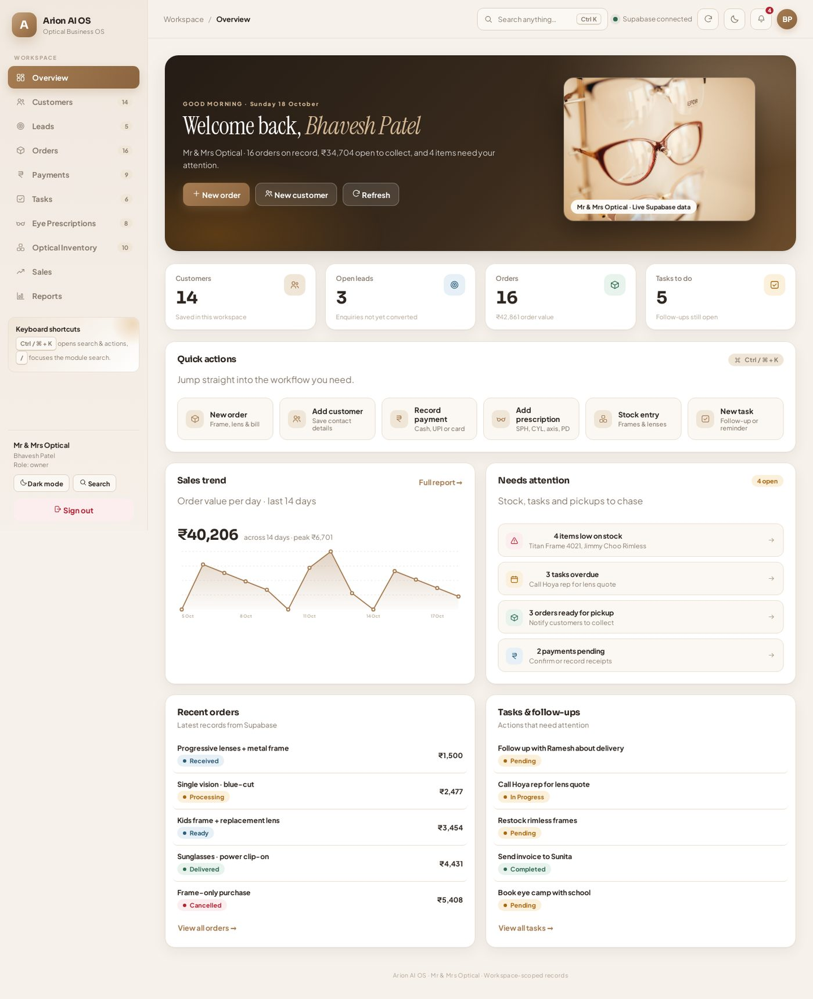
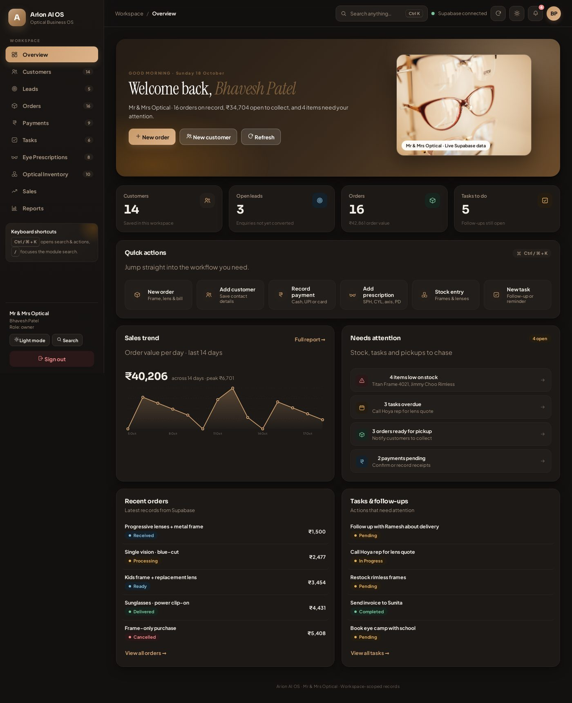
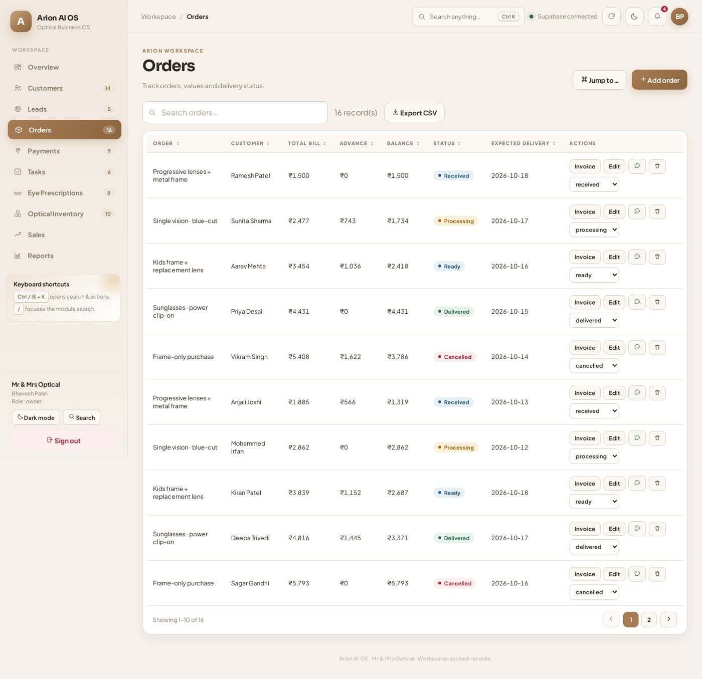

# Arion AI OS — Optical Business Workspace

A calm, fast workspace for optical shops: customers, eye prescriptions, orders, invoices,
payments, stock and profit reports — all backed by your existing Supabase project.



## What's new

### Design
- **Full UI redesign** in a warm "optical atelier" direction — cream canvas, espresso ink,
  brass accent, editorial serif moments and restrained, purposeful motion.
- **Dark mode** that keeps prescription and money data legible (toggle in the top bar or sidebar,
  choice is remembered per device).
- **New login screen** — split layout with real eyewear photography, feature list and an
  animated brand GIF.
- **Redesigned overview**: greeting hero, stat cards, an animated 14-day **sales trend chart**,
  quick actions, and a "Needs attention" feed (low stock, overdue tasks, orders ready for
  pickup, pending payments).
- Polished components throughout: status pills, sortable table headers, pagination,
  hover/focus states, staggered entrances, toasts, tooltips, empty states and animated loaders.
- Fully responsive: sidebar becomes a scrolling nav strip and cards stack on phones.
- Google Fonts: Sora (UI), Instrument Serif (brand moments), Plus Jakarta Sans (body).



### New functionality
- **Command palette** (`Ctrl / ⌘ + K`, or `/`): jump to any module, search customers and orders,
  and run actions (add order, record payment, switch theme, export CSV, sign out).
- **Toast notifications** for saves, deletes, status changes and errors.
- **Sortable columns + pagination** on every module table.
- **Delete a record** with confirmation (row actions).
- **Export CSV** for the current module, not just the reports page.
- **WhatsApp quick actions**: message a customer/lead directly, or share an order summary
  (amount, balance, status) from the orders table. Opens WhatsApp Web/app with the text
  prefilled — you still press send, so nothing goes out automatically.
- **Notification bell** with a badge counting everything that needs attention.
- **Sales trend chart** built from live order records (no invented sample data).



## Modules
Overview · Customers · Leads · Orders (invoice printing) · Payments (receipt printing) ·
Tasks · Eye Prescriptions · Optical Inventory · Sales · Reports.

## Tech
React 19 + Vite, Supabase JS v2 (auth, Postgres with Row Level Security, atomic RPCs for
orders/payments). No UI framework — hand-written CSS with design tokens.

```
src/
  App.jsx           app shell, auth, module logic, tables and forms
  ui.jsx            icons, status pills, chart, toasts, command palette, empty states
  reports.jsx       sales & reports page
  documents.jsx     printable invoice + payment receipt (HTML pop-up, print/PDF ready)
  utils.js          money formatting, sorting helpers
  App.css index.css design tokens and component styles (light + dark)
public/images       photography (see credits)
public/gifs         brand animations generated for this project
```

## Setup
1. `npm install`
2. Copy `.env.example` to `.env.local` and fill in your Supabase project URL and
   **publishable/anon** key (never a service-role key in the browser).
3. `npm run dev` — then open the URL printed in the terminal.
4. `npm run build` for a production bundle.

## Keyboard shortcuts
| Key | Action |
| --- | --- |
| `Ctrl / ⌘ + K` | Command palette |
| `/` | Open the command palette (when not typing) |
| `Esc` | Close palette / menus |

## Notes
- Row Level Security keeps every workspace's data separate; the app loads only the
  workspace the signed-in user belongs to.
- Orders and payments are written through Supabase RPCs with request IDs, so retrying a
  failed save cannot create duplicates.
- Invoices and receipts are non-GST documents unless you add your own GSTIN details.
- Validate reported totals against your books before relying on them for filing.

## Image credits
Photography in `public/images/` comes from Wikimedia Commons and Openverse (CC BY / CC BY-SA /
CC0) — see `public/images/CREDITS.json` for per-file source and license. The animations in
`public/gifs/` were generated for this project and are free to use with it.
